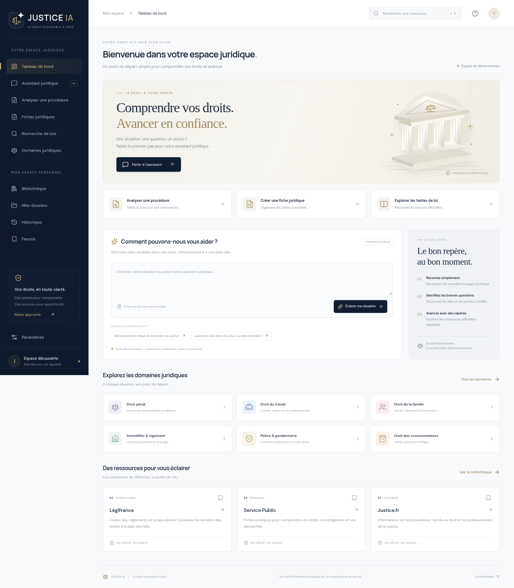

# JUSTICE IA

**Le droit accessible à tous.** Première version fonctionnelle, en français, d’un espace d’orientation juridique. Next.js, React, TypeScript ; identité bleu nuit et doré, adaptée aux mobiles.



Le [cahier des charges d’origine](docs/CAHIER_DES_CHARGES.md) est conservé dans le dépôt. Il décrit l’objectif final ; les fonctionnalités ci-dessous correspondent à la première étape réalisée.

## Démarrer

Prérequis : Node.js 24 (`.nvmrc`) et npm. Aucune clé API, aucun compte externe et aucune base de données ne sont nécessaires à cette version.

```bash
cd /workspace/JUSTICE-IA
npm ci
npm run dev
```

Le serveur utilise le port 3000. Pour le mode production :

```bash
npm run build
npm start
```

## Ce qui fonctionne

- Tableau de bord, navigation et accès direct à chaque écran par fragment d’URL (`#assistant`, `#folders`, etc.).
- Assistant de démonstration : réception du récit par une API serveur, suggestion parmi 23 domaines, guides spécialisés pour police, travail, logement et surveillance ; grille générale pour les autres domaines.
- Séparation explicite entre faits rapportés, absence de faits établis, hypothèses, questions complémentaires et démarches à examiner. La date des faits est acceptée mais **ne déclenche pas de vérification historique**.
- Analyse de procédure : récit guidé, questions sur les mesures et les droits notifiés. Aucune conclusion automatique sur une irrégularité ou une nullité.
- Trois présentations : citoyen ; avancé avec traçabilité ; professionnel avec grille documentaire. Elles utilisent le même moteur de démonstration.
- Fiches d’orientation : modification du récit puis nouvelle génération, enregistrement volontaire, copie, téléchargement texte, impression et enregistrement PDF via la boîte de dialogue d’impression du navigateur.
- Annuaire recherchable de huit sites institutionnels, filtré par domaine, avec favoris. Les liens ouvrent les sites officiels ; **le contenu intégral des lois n’est pas indexé**.
- Bibliothèque de fiches enregistrées et historique, dossiers avec notes modifiables, suppression individuelle et effacement de l’espace local.
- Import local `.txt` (20 Ko, 6 000 caractères maximum) dans le récit. Le contenu n’est envoyé au serveur qu’au lancement de l’orientation. Les PDF et fichiers Word ne sont pas pris en charge.

## Limites de la démonstration

Le moteur repose sur une classification par mots-clés et des guides prédéfinis : **ce n’est pas une IA générative, un moteur RAG ou un service de consultation juridique**. Il ne consulte aucun site en direct. Les sources de l’annuaire sont de vrais sites institutionnels, mais elles ne constituent pas des citations validant une réponse. Aucune loi, jurisprudence, date de publication, version historique ou échéance n’est générée comme si elle avait été vérifiée.

Il n’y a pas encore d’authentification, de compte, de synchronisation multi-appareils, de partage avec permissions ou de stockage PostgreSQL. Aucun délai de recours n’est calculé. L’application ne doit pas servir à prendre une décision juridique sans vérification professionnelle.

## Confidentialité

Le serveur ne conserve pas les récits dans une base de données et ne les transmet à aucun fournisseur IA. L’API ne journalise pas leur contenu. Cela n’exclut pas les journaux techniques de l’hébergeur.

Les fiches ne sont conservées que si l’utilisateur choisit « Enregistrer ». Dossiers, fiches, favoris et niveau de lecture sont stockés dans `localStorage`, sous la clé `justice-ia.workspace.v1`. **Ce stockage n’est pas chiffré ni protégé par un compte** : ne pas y mettre de données confidentielles ni l’utiliser sur un appareil partagé. Noms, adresses, documents sensibles et données de mineurs doivent être retirés des récits. L’effacement dans les paramètres supprime les données de ce navigateur, pas les fichiers téléchargés ou copiés ailleurs.

Les polices et icônes sont livrées avec l’application : aucun service de police distant, tracker ou outil d’analyse n’est requis par l’interface.

## Architecture

```text
src/app/page.tsx              Interface et parcours interactifs
src/app/globals.css           Design responsive, accessibilité, impression
src/app/api/assistant/route.ts API POST, validation Zod, réponse non mise en cache
src/lib/legal.ts              Domaines, annuaire officiel et moteur de démonstration
src/lib/storage.ts            Schéma et version du stockage local
tests/legal.test.ts           Classification, fiabilité, stockage et validation API
tests/e2e/workflow.spec.ts    Parcours réels dans Chromium, ordinateur et mobile
```

L’API valide la taille et le format du récit, le mode, le domaine et les dates ; les contenus utilisateurs sont affichés comme texte par React. Des en-têtes de protection contre l’intégration en iframe et la détection abusive de type MIME sont ajoutés. Ces mesures ne constituent pas une homologation de sécurité pour des dossiers réels.

## Vérifier

```bash
npm run typecheck
npm test
npm run build
npm run test:e2e
```

Les tests E2E nécessitent Chromium. Dans cet environnement, il est disponible dans `/usr/bin/chromium`. Ailleurs, définir `CHROMIUM_PATH` vers son exécutable. Playwright démarre le serveur de production s’il n’est pas déjà lancé ; exécuter le build auparavant. Captures et traces de tests sont générées dans `test-results/` et ne sont pas suivies par Git.

Validation effectuée le 13 novembre 2026 : installation `npm ci`, build de production et contrôle TypeScript réussis ; 5 tests moteur/API et 8 parcours E2E réussis (4 sur ordinateur, 4 sur mobile). Le contrôle des dépendances avec `npm audit --omit=dev` ne signalait aucune vulnérabilité à cette date. Ces résultats valident la démonstration, pas la fiabilité d’une IA juridique connectée ni un usage en production avec des dossiers sensibles.

## Prochaines étapes

1. **Sources et RAG** : connecter des API autorisées (notamment Légifrance via PISTE), ingérer les textes avec identifiants, versions, dates d’effet et dates de consultation ; tester la pertinence de la recherche et la fidélité des citations. Les accès externes et leurs conditions devront être configurés avant toute revendication de vérification.
2. **Fournisseur IA** : implémenter un adaptateur exclusivement côté serveur, documenter les variables nécessaires et la politique de conservation du fournisseur ; aucune clé dans le frontend. Imposer une réponse indiquant les informations manquantes et refuser les références non présentes dans les documents retrouvés.
3. **Comptes et PostgreSQL** : authentification éprouvée, sessions sécurisées, contrôle de propriété de chaque dossier, migrations, sauvegardes et règles de conservation. Migrer uniquement les données choisies par l’utilisateur.
4. **Documents et collaboration** : extraction PDF/Word, limites d’import, isolation des fichiers, permissions de partage révocables, export PDF natif, traitement spécifique des données de mineurs.
5. **Validation avant production** : revue juridique, évaluation sur des cas datés, tests d’autorisation, audit de sécurité, conformité et procédure de suppression complète.

Ce dépôt peut être développé sans service payant. Les intégrations ci-dessus ne sont pas activées ni simulées comme si elles l’étaient.
